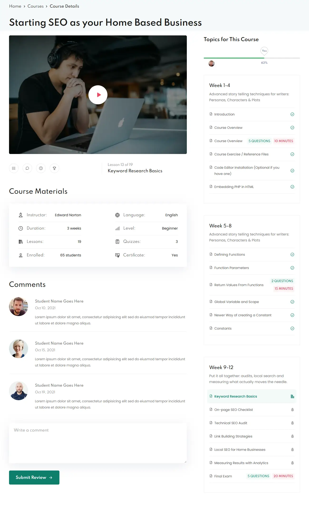
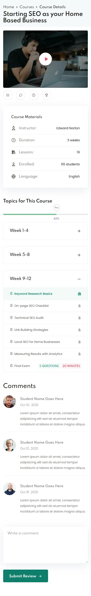

# ITLegend — Courses & Course Player

A small course-platform experience: a **courses page** that leads into a **Course Player** page rebuilt from the
ITLegend Figma reference (desktop + mobile), with working lessons, popups, progress and comments.

| Course Player (desktop)                                 | Course Player (mobile)                                |
| ------------------------------------------------------- | ----------------------------------------------------- |
|  |  |

## Quick start

```bash
npm install
npm run dev          # http://localhost:3000

# production build (what the numbers below were measured on)
npm run build && npm start
```

| Script                   | What it does                       |
| ------------------------ | ---------------------------------- |
| `npm run lint`           | ESLint (Next core-web-vitals + TS) |
| `npm run typecheck`      | `tsc --noEmit`                     |
| `npm run format[:check]` | Prettier + Tailwind class sorting  |

Routes:

- `/` — My Courses (8 demo courses)
- `/courses/[slug]` — Course Player, e.g. `/courses/seo-home-business` (the course from the design)

Progress, comments, exam attempts and the "ask a question" draft are stored in the browser. To reset the demo,
clear the site's `localStorage` / `sessionStorage` (keys start with `itlegend:`).

## Why this stack

**Next.js 16 (App Router) + React 19 + TypeScript + Tailwind CSS v4** — no UI or icon libraries.

- **Static by default.** Every page is pre-rendered at build time (`generateStaticParams`, `dynamicParams = false`).
  The mock JSON is read only on the server and each client component receives just the data it needs. The full
  dataset never ships to the browser.
- **Server / client split.** Pages and data access are Server Components. Interactivity lives in a few client
  islands (`CourseCatalog`, `CoursePlayer` and its children).
- **Built-in optimisation.** `next/image` (AVIF/WebP, responsive `sizes`, lazy loading), `next/font` (self-hosted,
  no layout shift), automatic code splitting.
- **Tailwind v4** keeps the measured values (`748fr/405fr` grid, `55px` rows, …) next to the markup. The colors live
  as design tokens in [`app/globals.css`](app/globals.css), so nothing is hard-coded twice.
- **No state library.** Persistence uses one ~90-line store built on `useSyncExternalStore`
  ([`lib/persistent-store.ts`](lib/persistent-store.ts)). The server renders the seed data and the client switches to
  saved data after hydration, with no hydration mismatch.

## Project structure

```
app/
  layout.tsx                 fonts (Spartan self-hosted, Poppins, IBM Plex Sans Arabic), metadata
  globals.css                design tokens, base styles
  page.tsx                   My Courses
  courses/[slug]/page.tsx    Course Player (SSG)
  not-found.tsx
components/
  ui/                        Modal (native <dialog>), Badge, Avatar, ProgressBar, icons
  layout/                    PageHeader (breadcrumb + title band), SiteHeader
  courses/                   CourseCatalog (filters + search), CourseCard
  player/
    CoursePlayer.tsx         page orchestrator: responsive grid, current lesson, wide mode, popups
    VideoPlayer.tsx          custom controls, Wide, Maximize/fullscreen, keyboard shortcuts
    ResourceStage.tsx        player area for PDF / exam lessons
    ActionBar.tsx            Curriculum · Comments · Ask a question · Leaderboard + lesson info
    CourseMaterials.tsx      CourseTopics.tsx  CurriculumSection.tsx  LessonRow.tsx
    CourseProgress.tsx       animated progress with the "You" marker
    Comments.tsx             list + CommentForm (reused by the question popup)
    modals/                  PdfViewerModal, ExamModal, AskQuestionModal, LeaderboardModal
data/                        courses.json, exams.json, comments.json, leaderboard.json, motivation.json
lib/
  courses.ts                 server-side data access
  course-utils.ts            pure helpers (progress %, status, formatting)
  persistent-store.ts        localStorage/sessionStorage-backed external store
  stores.ts                  progress, comments, exam attempts, question draft
  hooks/useInView.ts
types/course.ts
public/                      compressed images, sample videos, sample PDF
```

## Reading the design

The Figma file is a flat screenshot, so every value was measured from it:

1. Rendered the Figma canvas in headless Chrome at ~100% zoom and captured the desktop frame, the mobile frame and
   both popups at full resolution.
2. Measured edges, text bounding boxes and colors with small pixel-scanning scripts. Then I screenshotted my build at
   the same width (1300px desktop, 430px mobile) and compared them side by side until the checkpoints lined up. The
   title, video, Topics heading, progress bar, cards, materials card and comment form are all within ~1–3px.
3. The mobile frame is a devtools capture of the **EduBlink** template (iPhone 14 Pro Max, 430px). That gave the
   type families: headings in **Spartan** (the original, wider family; it's no longer in `next/font`'s catalog, so
   it's self-hosted) and body text in **Poppins**.

Key measurements (desktop): 1300px frame, 38px gutters, a `748 : 405` two-column grid with a 71px gap, 3:2 video,
55px lesson rows, 50px between topic cards. Main colors: `#181818` headings, `#808080` body text, `#F5F9FA` header
band, `#6ABD8A` progress, `#1AB69D` teal, `#EE4A62` red.

### Design notes implemented

The Arabic notes on the Figma canvas were treated as requirements:

- **Player:** sized as in the design and plays **in place** (not in a popup). On mobile it **sticks to the top while
  the content scrolls** (like YouTube). **Maximize** goes fullscreen and locks landscape on phones even with
  auto-rotate off (Screen Orientation API, with an iOS `webkitEnterFullscreen` fallback). **Wide** (desktop) makes
  the player full width and moves the course content below it.
- **Social icons replaced** by Curriculum / Comments (smooth-scroll to the section, stopping below the sticky
  player) and Ask a question / Leaderboard (popups).
- **Ask a question:** a popup with the same design as the comment box. The draft is kept for the session, so closing
  it by mistake loses nothing.
- **Leaderboard:** a popup with a message in the instructor's voice (Arabic, keyboard emoji). The message is picked
  from encouraging → stern tiers depending on how many classmates the student is ahead of. The seed data reproduces
  the design's "better than 60%" message.
- **Course Progress:** shows progress and the student's position, and fills when it scrolls into view.
- **PDF:** opens in a full-screen, closable popup.
- **Exam:** a full-screen, closable popup that saves answers, the current question and the remaining time on every
  change. Reopening resumes the attempt; submitting grades it and passing completes the lesson.

### Deliberate deviations

- **Contrast.** A few sampled colors fail WCAG AA for text (`#808080` body text, white on `#41B69D`). Text uses
  slightly darker values (`#767676`, `#0F7F6C`). The original colors are kept for decoration (progress bar,
  accents).
- **Course Materials.** The desktop design repeats the same four facts in both columns, so the second column shows
  four real ones (Level, Quizzes, Certificate). Phones show the five facts from the mobile design.
- **Lesson state.** The template shows a lock on every row. Here a check means completed, an equalizer means
  playing, and a lock means not completed yet. All lessons stay selectable.
- **Lesson info.** The current lesson title and position appear in the empty right half of the icon row (desktop)
  and as an overlay on the player.
- **Exam content.** The sample question's typos (Asam, Bahar, Kamaltake…) are corrected.

## Responsive behavior

- Fluid at every width, not two fixed layouts. Tested at 320, 375, 390, 430, 768, 1024, 1300, 1440 and 1920px with no
  horizontal scroll. `overflow-x: clip` is the safety net; `clip` rather than `hidden`, so the sticky player still works.
- **< 1024px:** single column in the mobile order (player → shortcuts → materials → topics → comments), a sticky
  player and accordion sections. **≥ 1024px:** two columns with the topics column spanning the left column's rows,
  plus Wide mode.
- Tested with long titles (`react-from-zero`), 3 to 19 lessons per course, and wrapped exam badges.
- Touch targets are at least 44px; the filter chips scroll horizontally on small screens.

## Accessibility

- Semantic landmarks and headings; breadcrumb `nav` with `aria-current`; `dl` for course facts; `ol` for lessons,
  comments and the leaderboard.
- Popups use the native `<dialog>` element: focus trapping, Esc to close, an inert background and a titled
  `aria-labelledby`.
- The player is a labelled region with keyboard shortcuts (Space/K play, ←/→ seek, M mute, F fullscreen). Every
  control has a label, and the seek bar has `aria-valuetext`.
- The progress bar has `role=progressbar` with a readable value. Exam options are real radio inputs inside a
  `fieldset`, and the timer has `role=timer`.
- Status messages use `role=status` / `aria-live`, decorative images use `alt=""`, and `prefers-reduced-motion` is
  respected.

## Performance

- All pages are SSG; the mock data stays on the server.
- Images are resized and compressed ahead of time (WebP, ~20–35 KB covers, ~2–4 KB avatars, ~290 KB total) and
  served through `next/image` as AVIF/WebP with responsive `sizes`. The LCP image (player poster / first cards) is
  preloaded or fetched eagerly; everything else is lazy.
- Videos use `preload="none"`, so nothing is downloaded until the student presses play.
- Fonts are self-hosted: one 33 KB variable Spartan file, two Poppins weights, and the Arabic font only when the
  leaderboard needs it.
- No runtime dependencies beyond `next`, `react` and `react-dom`.

Lighthouse 12 on the production build (`next build && next start`):

| Page                 | Device  | Performance | Accessibility | Best practices | SEO |
| -------------------- | ------- | ----------- | ------------- | -------------- | --- |
| `/courses/seo-home…` | Desktop | 100         | 100           | 100            | 100 |
| `/courses/seo-home…` | Mobile  | 92–94       | 100           | 100            | 100 |
| `/` (My Courses)     | Desktop | 100         | 100           | 100            | 100 |
| `/` (My Courses)     | Mobile  | 87–89       | 100           | 100            | 100 |

Mobile is Lighthouse's simulated slow-4G/4× CPU profile (scores vary ±2 between runs); CLS is ≤ 0.002 everywhere.

## Verified flows

These were checked with a scripted headless-Chrome run against the production build:

- Catalog: 8 courses, status filters, search, Start/Continue/Review routes into the player
- Play, Wide mode on/off, select a lesson (marks it current, swaps the video, updates the lesson info)
- PDF popup opens and closes with Esc
- Exam: answer, close, reopen on the same question with answers kept, submit, see the result
- The question draft survives closing the popup; the leaderboard shows the Arabic message
- A new comment appears in the list and survives a reload; the current lesson is restored after a reload
- Mobile: the player sticks to the top, and the Curriculum shortcut lands below it
- No console errors

## Credits

Course photos: [Unsplash](https://unsplash.com) (Unsplash License). Portraits: [randomuser.me](https://randomuser.me).
Sample clips: [test-videos.co.uk](https://test-videos.co.uk) (Big Buck Bunny, Sintel © Blender Foundation, CC BY)
and the MDN CC0 sample. Spartan, Poppins and IBM Plex Sans Arabic are licensed under the SIL Open Font License.
